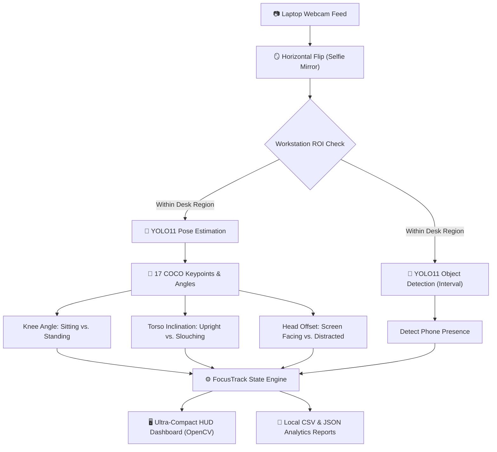

<div align="center">

# 🎯 FocusTrack AI

### *Real-Time Ergonomics, Habit Monitoring & Distraction Analytics*

[](https://www.python.org/)
[](https://github.com/ultralytics/ultralytics)
[](https://opencv.org/)
[](https://pytorch.org/)
[](#-privacy-first-architecture)
[](LICENSE)

<br/>

<p align="center">
  <b>FocusTrack AI</b> is an intelligent, privacy-preserving desktop computer vision assistant designed to monitor posture, track sedentary patterns, detect digital distractions, and log healthy work habits in real-time — all running 100% locally on your machine.
</p>

</div>

---

## 📑 Table of Contents

- [✨ Key Features](#-key-features)
- [🔒 Privacy-First Architecture](#-privacy-first-architecture)
- [🏗️ How It Works](#️-how-it-works)
- [🚀 Quick Start](#-quick-start)
- [🎮 Controls & Keyboard Shortcuts](#-controls--keyboard-shortcuts)
- [📊 Analytics & Exported Reports](#-analytics--exported-reports)
- [⚙️ Configuration](#️-configuration)
- [📂 Project Structure](#-project-structure)
- [🛠️ Tech Stack](#️-tech-stack)

---

## ✨ Key Features

| Capability | Description |
| :--- | :--- |
| **🪞 Mirrored Selfie Stream** | Intuitive horizontal mirroring — holding your phone or moving on your right reflects seamlessly on the right side of the screen. |
| **🧍 Posture & Ergonomics** | Dual-model pose estimation analyzes 17 COCO skeletal landmarks to categorize Sitting vs. Standing and detect torso slouching/leaning. |
| **⏱️ Sedentary Habit Defense** | Tracks continuous sitting time and workstation presence to combat prolonged inactivity and support healthy interval breaks. |
| **📱 Distraction & Phone Detection** | Runs optimized YOLO11 object detection at adaptive frame intervals to capture phone usage without taxing CPU/GPU pipelines. |
| **🎯 Custom Workstation ROI** | Interactive Region of Interest (ROI) selection allows you to isolate your desk space and ignore background foot traffic. |
| **⚡ Ultra-Compact Heads-Up Display** | Low-profile, sleek semi-transparent dashboard overlay occupying only ~16% of the screen with quick show/hide toggle. |
| **📈 Multi-Tier Analytics** | Exports chronological event logs (`.csv`), granular session profiles (`.json`), and rolling 7-day summary metrics (`.json`). |

---


## 🔒 Privacy-First Architecture

> [!IMPORTANT]
> **No video files are EVER recorded, streamed, or stored.**

- **100% Offline Processing**: Frame analysis occurs strictly in volatile memory (RAM) via local PyTorch and OpenCV pipelines.
- **Zero Cloud Reliance**: No audio capture, no telemetry transmission, and no external server pings.
- **Data Minimization**: The only files saved to disk are lightweight, anonymous timestamped metric summaries and activity event logs in `reports/`.

---

## 🏗️ How It Works



---

## 🚀 Quick Start

### Prerequisites
- **Python 3.10+** (Tested on Python 3.12)
- Built-in laptop webcam or USB camera
- Windows, macOS, or Linux

### 1. Clone & Navigate
```bash
git clone https://github.com/your-username/FocusTrack-AI.git
cd FocusTrack-AI
```

### 2. Install Dependencies
```bash
pip install -r requirements.txt
```

> [!TIP]
> If you have an NVIDIA GPU with CUDA, install the CUDA-enabled PyTorch build for 60+ FPS processing. FocusTrack automatically detects CUDA and falls back to CPU if unavailable.

### 3. Launch FocusTrack AI

#### 🪟 Windows (One-Click)
Double-click `start.bat` in File Explorer.

#### 💻 Terminal (Cross-Platform)
```bash
python focustrack.py
```

*On the very first launch, YOLO11 model weights (`yolo11n-pose.pt` and `yolo11n.pt`) will download automatically (~11MB total).*

---

## 🎮 Controls & Keyboard Shortcuts

Interact with the live camera window using the following keys:

| Key | Action | Description |
| :---: | :--- | :--- |
| **`R`** | **Select ROI** | Click and drag on the window to calibrate your workstation area. |
| **`X`** | **Reset ROI** | Restores monitoring to the entire camera frame. |
| **`M`** | **Toggle Mirror** | Switches between natural selfie view (mirrored) and standard camera feed. |
| **`H`** | **Toggle HUD** | Shows or hides the top-left analytics dashboard overlay. |
| **`E`** | **Export Now** | Generates snapshot CSV and JSON reports immediately in `reports/`. |
| **`Q` / `ESC` / `[X]`** | **Quit & Export** | Cleanly terminates the session and generates final aggregated summaries. |

---

## 📊 Analytics & Exported Reports

Whenever you press `E` or exit with `Q`, FocusTrack compiles session metrics into the `reports/` directory:

```
reports/
├── events_20261104_143000.csv       # Chronological log of transitions & detections
├── session_20261104_143000.json      # Granular session statistics & totals
├── daily_summary_2026-11-04.json     # Aggregated day-long productivity metrics
└── weekly_summary_2026-11-04.json    # Rolling 7-day ergonomics overview
```

### Sample Event CSV (`events_*.csv`)
```csv
timestamp,event,details
2026-11-04T10:15:22,WORKSTATION_DETECTED,Initial person detection
2026-11-04T10:15:24,POSTURE_CHANGED,Posture changed to SITTING
2026-11-04T10:18:10,PHONE_DETECTED,Mobile phone visible at workstation
2026-11-04T10:35:45,DEPARTURE_CONFIRMED,Away for 182.4s
```

### Sample Session Summary (`session_*.json`)
```json
{
    "start_time": "2026-11-04T10:15:22",
    "end_time": "2026-11-04T11:00:22",
    "workstation_seconds": 2420,
    "sitting_seconds": 1820,
    "standing_seconds": 600,
    "break_count": 2,
    "away_seconds": 280,
    "phone_visible_seconds": 64,
    "head_turned_seconds": 112,
    "leaning_seconds": 45
}
```

---

## ⚙️ Configuration

Tune operational parameters directly at the top of `focustrack.py`:

```python
# ============================================================
# CONFIGURATION
# ============================================================
CAMERA_INDEX = 0               # Default webcam device index
CAMERA_WIDTH = 1280            # Preferred capture width
CAMERA_HEIGHT = 720            # Preferred capture height
MIRROR_CAMERA = True           # Enable natural selfie mirroring

PHONE_DETECTION_INTERVAL = 10  # Run object detection every N frames (CPU optimization)
AWAY_CONFIRM_SECONDS = 3.0     # Grace duration before confirming workstation departure
POSTURE_CONFIRM_SECONDS = 1.2  # Hysteresis buffer to avoid posture classification flicker
KEYPOINT_CONFIDENCE = 0.25     # Minimum threshold for skeletal keypoint validity
```

---

## 📂 Project Structure

```
FocusTrack-AI/
├── 📄 focustrack.py          # Core computer vision pipeline & state engine
├── 📜 requirements.txt       # Python dependencies (ultralytics, opencv, numpy, torch)
├── 🚀 start.bat              # Windows one-click desktop launcher
├── 🛡️ .gitignore             # Ignores weights, temporary logs, reports, and caches
├── 📖 README.md              # Documentation & user guide
├── 📂 reports/               # Output destination for CSV and JSON analytics
│   └── 📄 .gitkeep
├── ⚖️ yolo11n-pose.pt         # Auto-downloaded YOLO11 pose weights (git-ignored)
└── ⚖️ yolo11n.pt              # Auto-downloaded YOLO11 detection weights (git-ignored)
```

---

## 🛠️ Tech Stack

- **Computer Vision**: [OpenCV](https://opencv.org/) (`opencv-python`)
- **Deep Learning Framework**: [PyTorch](https://pytorch.org/) (`torch`, `torchvision`)
- **Object Detection & Pose Tracking**: [Ultralytics YOLO11](https://docs.ultralytics.com/) (`yolo11n-pose.pt`, `yolo11n.pt`)
- **Scientific Computing**: [NumPy](https://numpy.org/)

---

<div align="center">

Made with ❤️ for healthier, more focused workdays.

⭐ **Star this repository if you find it helpful!**

</div>
<p align="center">
  Developed By Abu Bakar Rakib
</p>

